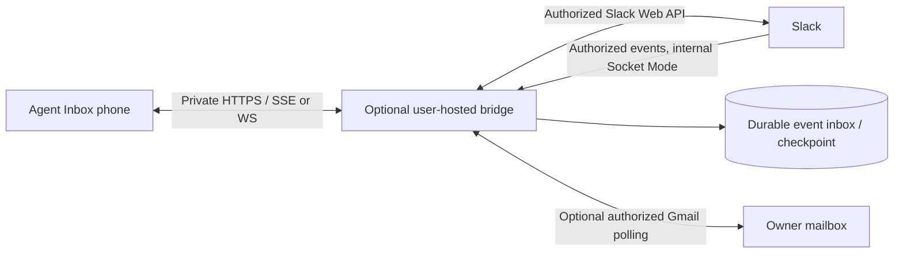

# Optional event-driven bridge (later / internal only)

> Moved verbatim from `Product.md` into this file. Section numbers (§) are the `Product.md` numbering; `Product.md`'s section index links each number here. [`docs/architecture/README.md`](README.md) maps every moved section to its file. Precedence is unchanged: material from §§23–24 overrides material from earlier sections, and superseded passages carry an explicit note.

## 24.9 Event-driven architecture — optional later/internal path

Baseline: direct device OAuth and foreground polling for authorized Slack/Gmail where permitted; no mandatory app-owned runtime. Internal advanced prototype: user-hosted bridge using Slack Events API Socket Mode with user-event subscriptions that actually authorize the target conversations. Socket Mode requires a separate app-level token with `connections:write`; never embed it in the mobile bundle. It avoids a public callback endpoint but is **not currently permitted in public Slack Marketplace apps**. Therefore do not choose Socket Mode as the default commercial distribution design.

If public event-driven support is needed, evaluate an approved Slack Events API HTTPS receiver with signature/time verification, replay protection, timely acknowledgement, durable idempotent event queue, scoped delivery to authenticated devices and catch-up API. Slack app credentials and signing secret stay server-side; verify events match authorized installations, conversation and sender. A shared commercial receiver changes architecture, cost and privacy obligations and requires approval before implementation. A user-hosted bridge is not a loophole around Slack distribution terms. An HTTPS receiver may be user-hosted only where supported and policy-compliant. Gmail push/watch with Cloud Pub/Sub is a separate optional infrastructure decision, not required for baseline. Never promise delivery while the device or user-hosted bridge is offline. APNs/FCM, cross-device sync, cloud storage and multi-agent orchestration remain deferred.

Candidate bridge API, for a future ADR only: `GET /v1/health`, `GET /v1/connections/{id}/events?cursor=...`, `POST /v1/connections/{id}/messages` (explicit user command), `GET /v1/connections/{id}/requests/{requestId}`. Require paired device credentials, strict owner authorization, TLS, request size/rate limits, stable cursors, durable replayable events, no generic proxy or arbitrary outbound URL, and no automatic retry of ambiguous provider sends. Choose runtime (TypeScript or FastAPI), storage and deployment only if approved after discovery. The mobile app must not require bridge for already working direct integrations.
