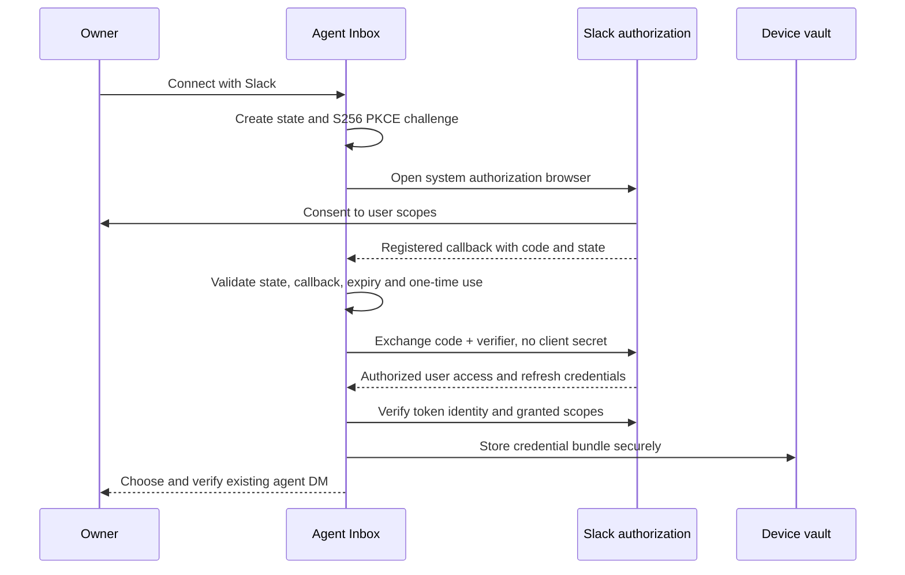

# Slack transport (ChatGPT Dot, Grok Bot)

> Moved verbatim from `Product.md` into this file. Section numbers (§) are the `Product.md` numbering; `Product.md`'s section index links each number here. [`docs/architecture/README.md`](../README.md) maps every moved section to its file. Precedence is unchanged: material from §§23–24 overrides material from earlier sections, and superseded passages carry an explicit note.

## 24.4 Slack transport — ChatGPT Dot first, Grok Bot second

**Prerequisite:** owner connects their existing agent to Slack through the provider's official setup, then confirms manual send/reply in its intended conversation. Test using a dedicated development workspace/account with no sensitive history. Confirm workspace app installation permissions. The owner's authorization matters: a token belonging to Agent Inbox's bot does not give it access to arbitrary owner-to-agent DMs. Even a valid owner token may not trigger the personal agent when messages originate through an API. This is the primary technical hypothesis to validate, not a feature guarantee.

### A. Create development Slack app

1. In [Slack developer portal](https://api.slack.com/apps), create a development app for the test workspace. Configure OAuth & Permissions; use user scopes `chat:write`, `im:read`, `im:history` for the direct-message-only prototype, subject to method-specific validation. Do not request channel, admin, file, search or user-directory scopes unless an additional use case is approved. If the intended DM cannot be discovered under these scopes, prefer explicit selection of a permitted conversation; request additional scope only with justification.
2. Enable PKCE and register the exact callback URI for each development/production app. Use separate OAuth client configurations per environment. Native custom-scheme PKCE clients cannot request bot scopes in this flow. Public client identifiers may be bundled, secrets may not.
3. Install/authorize as the agent owner. For a first command-line internal spike, securely provide a legitimate development user token via a local secret mechanism; never paste it into chat, commit it, or ship it in the mobile build. The production UX uses OAuth, not manual token copying.
4. Validate token owner/workspace with `auth.test` and list allowed IMs with `conversations.list` (`types=im`, pagination). Select the exact existing agent DM. Verify membership and intended counterpart using permitted metadata and the known manual conversation; do not scan unrelated conversation contents. The workspace ID + owner user ID + conversation ID + confirmed provider counterpart form the binding.

### B. Mobile OAuth sequence

Use Expo-compatible OS authorization session tooling validated against the pinned SDK and standalone development builds; do not depend on Expo Go callback behavior. Generate cryptographically random verifier and state, use S256, store only short-lived flow state in memory or protected storage if needed, reject mismatched/expired/replayed callbacks. For native URI `agentinbox://oauth/slack` (illustrative; register final unique scheme), construct `https://slack.com/oauth/v2/authorize` with `client_id`, `scope` empty for user-only flow, `user_scope`, `redirect_uri`, `state`, `code_challenge`, `code_challenge_method=S256`. Exchange through documented `oauth.v2.access` with code, client ID, verifier and redirect URI; parse actual returned user credentials and granted scopes, not a bot token or OIDC identity token. Refresh via documented PKCE refresh grant without embedding client secret. Respect returned expiry; Slack PKCE refresh tokens expire after 30 days and native custom redirects use rotating credentials. Serialize refresh per credential, persist replacement token bundle before resuming requests, handle rotation failures with reauthorization. Do not log URLs containing codes, token payloads or callback data.

### C. API method mapping

| Method | Input/behavior | Persisted non-secret result |
|---|---|---|
| `auth.test` | User bearer token | Verified workspace and owner ID |
| `conversations.list` | `types=im`, cursor; user `im:read` | Eligible conversation metadata only |
| `conversations.info` | Exact permitted conversation, if needed | Confirm binding, not agent liveness |
| `chat.postMessage` | Exact channel, text; optional `thread_ts` only after validated; user `chat:write` | Channel + message `ts`, accepted status |
| `conversations.history` | Bound channel; bounded time window, cursor, `im:history` | Message IDs and scoped history |
| `conversations.replies` | Bound channel and real thread root `ts`; verify token permissions | Threaded replies with their own message IDs |
| `auth.revoke` | Authorized credential, if supported for selected token lifecycle | Revocation result, not remote message deletion |

Use fixed HTTPS Slack API origin. Validate HTTP status **and** Slack JSON `ok`; handle `error`, pagination and `Retry-After`. Do not attach authorization to arbitrary user-provided URLs or redirects. The user explicitly triggers every outbound `chat.postMessage`; no automatic response to incoming agent messages. API acknowledgement is not completion. Slack message timestamps are opaque decimal strings, not JavaScript floating-point numbers.

### D. Two-way PoC and success evidence

Send a harmless unique probe such as `Agent Inbox connection test [<random nonce>]. Please reply with the same code only.` via the official Slack API using the owner's authorized user token. Record request ID, channel, accepted Slack `ts`, timestamp and sanitized outcome. Wait via allowed history/replies reads. Confirm a reply from the expected agent identity in the same bound conversation (including a thread if used), with nonce echoed. Repeat with a follow-up and confirm the existing agent—not a substitute model—responds. Compare with the manual control message. Verify that the owner can still see the same messages in Slack. If the agent ignores API-originated messages, returns a provider-side approval, cannot be read, or identity cannot be established, record the precise failure; do not switch to unofficial routes.

For Grok Bot, repeat the entire probe under the user's actual Bot entitlement and linked Slack workspace. Do not assume Dot's behavior transfers to Grok. For optional routine webhooks, store submission receipt as `accepted` only, authenticate according to provider docs, never treat a webhook HTTP response as agent answer, and do not enable chat without a separately validated reply path.
