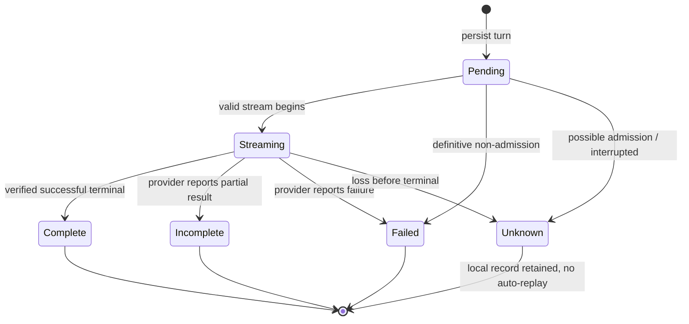
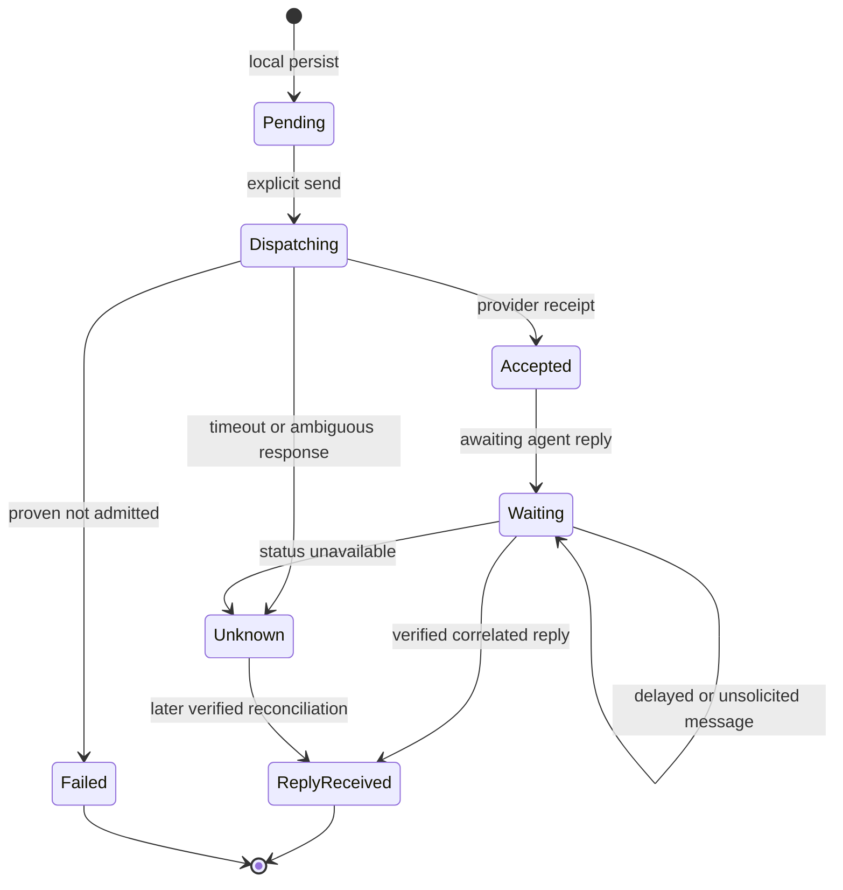

# Request state machines and message synchronization

> Moved verbatim from `Product.md` into this file. Section numbers (§) are the `Product.md` numbering; `Product.md`'s section index links each number here. [`docs/architecture/README.md`](README.md) maps every moved section to its file. Precedence is unchanged: material from §§23–24 overrides material from earlier sections, and superseded passages carry an explicit note.

## 11. State machine and request semantics

Persist pending before dispatch; generate local request ID; reject concurrent sends for the same agent; dispatch once per accepted user action. Mark pending/streaming turns left by a killed process as unknown on restart unless definitive non-admission or terminal evidence was already persisted. Never auto-dispatch on route mount, foregrounding or network reconnection. Explicit new submission gets a new request ID and warning if earlier outcome is uncertain. A local ID is not provider-side deduplication. If user intentionally starts another task after an unknown one, the prior task may still execute. v1 does not guarantee remote cancellation, reconciliation or exactly-once execution.

## 24.7 Durable submission, message synchronization and state machines

`ReplyReceived` is not a guarantee that the task itself succeeded; only explicit supported run-state events can convey completion/failure. A waiting deadline is a UI hint, not proof of failure. Local pending/dispatching state left after app kill is reconciled conservatively: if dispatch may have occurred, set unknown and sync; never auto-replay. Explicit retry after definitive non-admission is user initiated. If outcome unknown, show warning and allow deliberate new request only after user confirmation. Use provider idempotency only when documented, not local IDs alone.

Outbound transaction: validate text and binding snapshot; acquire per-agent send lock; create request and local message; persist pending before network; mark dispatching; send once; persist accepted external identifier atomically with status or classify error. Reconcile echoed owner messages by exact provider ID (or verified provider-supported client ID), not text equality. If echo arrives before receipt, temporarily store it separately and merge only on reliable identity. Do not lose unsolicited agent messages. Prevent concurrent uncorrelated PoC tasks to the same remote conversation across local bindings; do not promise cross-device exclusivity.

Inbound sync algorithm:

1. Start on verified connection, chat foreground, explicit refresh, network restoration or application resume. Skip when offline, reauth required or disconnected. One in-flight job per remote binding; central scheduler shares rate limits by account/workspace/method. Cancel obsolete jobs when binding generation changes.
2. Start with a bounded recent history window after user consent (default: since binding/probe time; no bulk import). Use provider timestamps/message IDs, cursor and overlap to avoid boundary loss. For Slack, handle newest-first pages, fixed upper window, exact decimal timestamp comparison and separate thread discovery/checkpointing. For Gmail use filtered list/thread IDs and a bounded re-scan if a history cursor expires. Do not advance a global high-water mark until all pages in its window are committed.
3. Filter every event by exact authorized workspace/account, conversation, thread rules and expected sender. Skip unknown/unsupported event types safely. Owner messages from Slack/Gmail outside app may appear as owner messages only in the selected conversation. Keep distinct provider message IDs; edits/deletions update or tombstone records when observed, without claiming full real-time history parity.
4. Upsert normalized records, correlations and checkpoint in a single SQLite transaction. Unique external identity prevents duplication across pagination, retries and app restarts. Discard any result from stale binding generation. Render chronological stable ordering; keep provider timestamp as string plus deterministic tie-breaker. Missing request correlation does not prevent displaying legitimate unsolicited agent replies.
5. Schedule next read only while foregrounded, respect quota and `Retry-After`, jitter/backoff on transient failures and avoid hot loops. For an eligible internal PoC, propose a 5–10 second active-chat polling interval if permitted; never use that cadence for restricted installations. Stop routine polling when backgrounded. On reopen, catch up without sending anything. iOS/Android background execution is not guaranteed; no background notifications in baseline.

Rate limits: Slack history/replies for affected non-Marketplace commercial installations are limited to one request/minute per method and smaller pages (15); internal customer-built apps have different limits. Treat limits as runtime policy and verify installation class. Don't bypass them with multiple tokens/apps, parallel jobs or repeated manual refresh. For public distribution, Slack Marketplace/terms and approved method access are release gates. Gmail quota and retry behavior are likewise enforced centrally. A paused/suspended app may show new messages only on its next successful sync; show last sync and stale state honestly.
