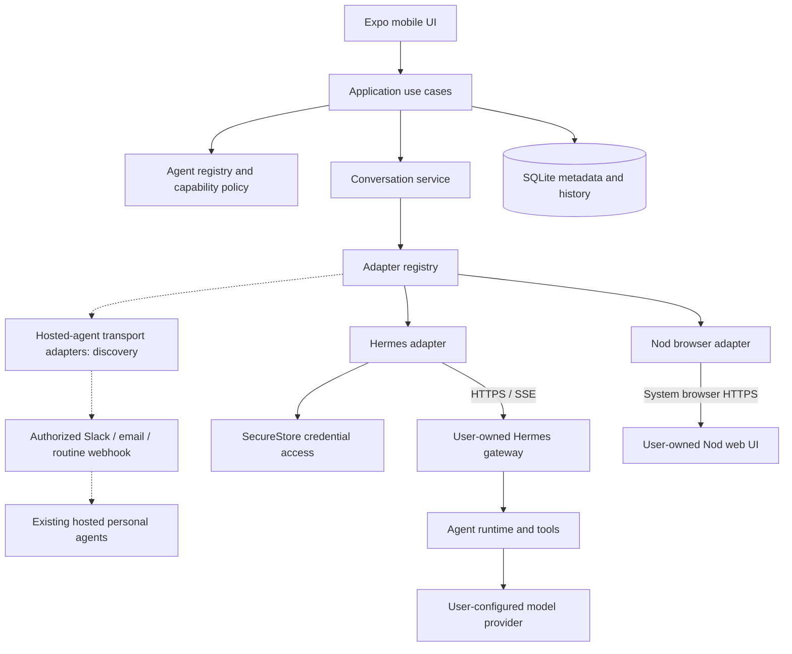
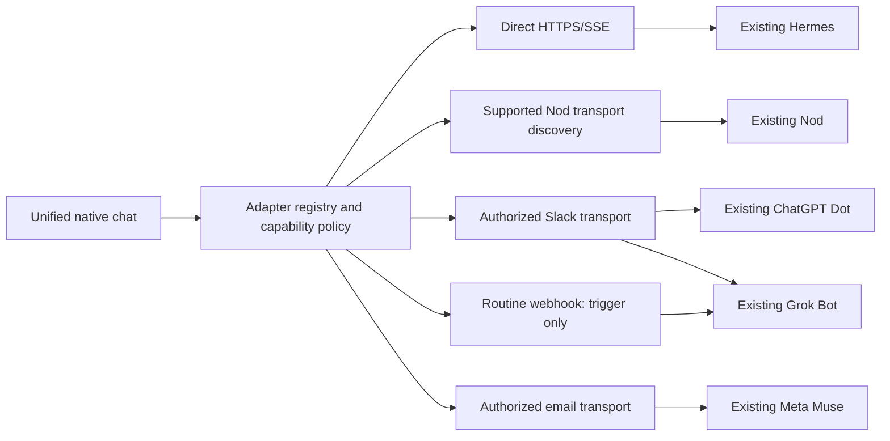
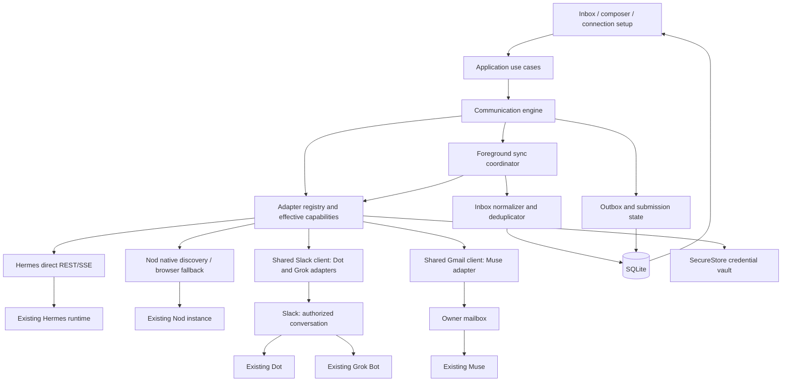

# System architecture overview

> Moved verbatim from `Product.md` into this file. Section numbers (§) are the `Product.md` numbering; `Product.md`'s section index links each number here. [`docs/architecture/README.md`](README.md) maps every moved section to its file. Precedence is unchanged: material from §§23–24 overrides material from earlier sections, and superseded passages carry an explicit note.

## 7. System architecture



There is no company-operated API gateway, central database, remote agent scheduler or credential relay in v1. The phone is not a server. It does not proxy the user's model traffic through our infrastructure. App stores and build services remain distribution dependencies, not a runtime agent backend.

### 7.1 Responsibility boundaries

| Component | Owns | Does not own |
|---|---|---|
| Mobile UI | Navigation, composer, rendering, errors | Tool execution, auth enforcement on server |
| Application services | Validation, dispatch, state transitions, persistence coordination | Provider-specific wire format |
| Adapters | Provider requests, parsing, capability mapping | UI rendering, direct screen state |
| Local repositories | SQLite records and migrations | Bearer secrets |
| Credential vault | SecureStore lifecycle | Agent API authorization rules |
| User agent | Execution, permissions, memory, connected accounts | Mobile local history |
| Private network / HTTPS proxy | Reachability and transport security | Mobile task semantics |

### 7.2 Proposed tech stack

- React Native, Expo, TypeScript strict mode; Expo Router navigation.
- `expo/fetch` for streamed network responses; validate actual SDK and OS behavior before release.
- `expo-secure-store` for credentials; `expo-sqlite` for relational local data; `expo-application` for native version/build; system Linking for browser and stores.
- React state/hooks initially, or a small state store only if needed; persistent state remains in repositories, not in UI state.
- Jest / React Native Testing Library for unit and component tests; Maestro or equivalent for end-to-end smoke tests; EAS Build/Submit for distribution.
- Pin compatible Expo SDK and package versions after a streaming proof of concept. Commit lockfile. No mandatory FastAPI, Redis, PostgreSQL, LangGraph, WebSocket service or cloud account for the client MVP.

### 7.3 Proposed repository structure

```text
agent-inbox/
├── .github/                   # CI workflow, PR and issue templates
├── assets/                    # App icon, adaptive icon, splash, favicon
├── src/
│   ├── app/                   # Expo Router routes and layouts (Expo SDK 58 default location)
│   │   ├── _layout.tsx
│   │   ├── index.tsx
│   │   ├── add-agent.tsx
│   │   ├── agents/[agentId]/
│   │   │   ├── index.tsx
│   │   │   ├── settings.tsx
│   │   │   └── chat/[threadId].tsx
│   │   └── settings.tsx
│   ├── domain/                # Models, states, errors, capabilities
│   ├── application/           # Use cases and services
│   ├── adapters/              # Grouped by transport (see §24.11)
│   │   ├── registry.ts
│   │   ├── hermes/            # Direct API, mapping and SSE handling
│   │   ├── nod/               # Validated browser handoff; native discovery
│   │   ├── slack/             # Shared Slack client; Dot and Grok adapters, capability gated
│   │   └── gmail/             # Shared Gmail client; Muse adapter, capability gated
│   ├── infrastructure/
│   │   ├── database/          # Migrations and repositories
│   │   ├── credentials/       # SecureStore wrapper
│   │   └── networking/        # HTTPS policy, abort and errors
│   ├── features/              # Screen-specific UI and hooks
│   ├── components/            # Reusable accessible components
│   ├── hooks/                 # Shared React hooks (color scheme, theme)
│   └── theme/
├── tests/{unit,integration,fixtures,e2e}/
├── docs/
│   ├── adr/                   # Architecture decision records
│   ├── integrations/          # Redacted provider evidence and status matrix
│   ├── screens/               # Per-screen functional specifications (S01–S07)
│   ├── design/                # Visual reference: clickable HTML prototype and board images
│   ├── testing/               # Testing strategy, acceptance IDs C01–C16 and gate mapping
│   ├── product/               # Overview, scope, IA, NFRs, roadmap, decisions, references
│   ├── hosted-agents/         # Hosted-agent scope, discovery, UX/security rules, engine decision
│   ├── delivery/              # Handoff and ordered gates, definition of done, CI/CD
│   ├── architecture/
│   ├── setup/
│   └── security/
├── spikes/                    # Internal provider discovery spikes (§24.11)
├── AGENTS.md
├── Product.md
├── Roadmap.md
├── CHANGELOG.md
├── app.json                   # Expo config (app.config.ts if dynamic config is needed)
├── eas.json                   # Added with EAS builds (Gate 5)
├── eslint.config.js
├── tsconfig.json
├── package.json
└── README.md
```

Routes live in `src/app/`, the Expo SDK 58 default; the routes listed under it are planned, and only `_layout.tsx` and `index.tsx` exist after the Gate 1 scaffold. Adapters are grouped by transport, not by provider: the same Slack or Gmail client serves several agent adapters without mixing bindings or histories (§24.6). The file-level breakdown in §24.11 extends this tree. Dependency direction: UI → application → domain contracts; infrastructure and providers implement those contracts. No direct credential access from screen components. Start with statically registered trusted adapters, not arbitrary downloaded executable plugins.

## 23.2 Transport architecture (proposed)



The Slack and email routes are hypotheses for in-app two-way messaging. Implement the smallest discovery prototype before product UI. Direct API support is preferred when documented. A user-owned optional bridge is acceptable for secure OAuth exchange, provider event ingestion and durable processing if direct mobile access is impractical; it must not create an obligation for Agent Inbox to host a backend. If a production integration requires a confidential OAuth client, server-side token exchange or a public webhook receiver that cannot be safely user-hosted, document the architecture/cost trade-off and seek scope approval rather than embedding secrets or promising a serverless solution. Foreground polling and catch-up are candidates for the baseline; durable background notifications are separate scope.

## 24.2 Runtime topology and message ownership



The outbound flow is user intent → local transaction → credential and binding validation → provider API → accepted receipt or failure. The inbound flow is provider event/history → authorized transport fetch → strict conversation/identity filter → normalize → transactionally upsert messages and advance sync state → UI observes local records. The provider owns the actual execution and its memory. The phone owns its local projection of conversations. A transport can be reachable while the agent is offline; never conflate the two.

## 24.11 Proposed implementation tree (extension to §7.3)

```text
src/
  domain/
    communication/{binding,capabilities,events,receipt,errors}.ts
  application/
    communication/{engine,send-use-case,sync-coordinator,reconciler,probe}.ts
    auth/{oauth-session,account-service,refresh-lock}.ts
  adapters/
    slack/{client,oauth,history,normalizer,dot-adapter,grok-adapter}.ts
    gmail/{client,oauth,mime,normalizer,muse-adapter}.ts
    hermes/{client,stream-parser,adapter}.ts
    nod/{browser-adapter,native-discovery}.ts
  infrastructure/
    database/{migrations,repositories,checkpoints}.ts
    credentials/{vault,rotation-journal}.ts
    networking/{http,rate-limiter,backoff}.ts
  features/
    connections/{catalog,auth,bind,probe,reauthorize}.tsx
    chat/{conversation,composer,message-status,sync-indicator}.tsx
    settings/{account-connections,disconnect}.tsx
spikes/
  slack-dot/README.md
  slack-grok/README.md
  gmail-muse/README.md
  nod-native/README.md
  hermes-mobile/README.md
```

Folder names illustrative. Keep transport HTTP clients reusable, domain contracts provider-independent, credentials outside React components and tests independent of real accounts. Spike credentials supplied via approved local secret mechanism, never fixtures. Mock adapter available only in explicit demo/test mode with visible simulated label.
